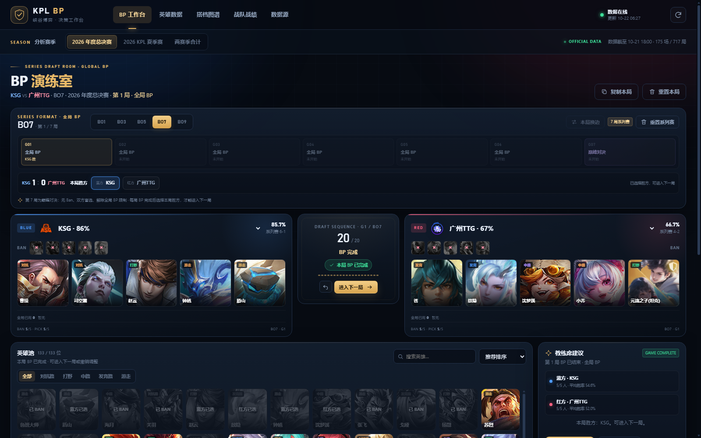
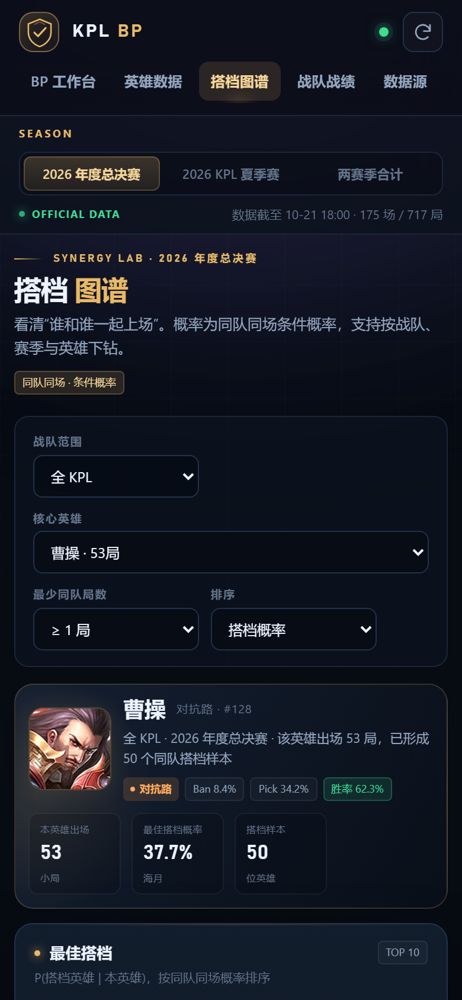
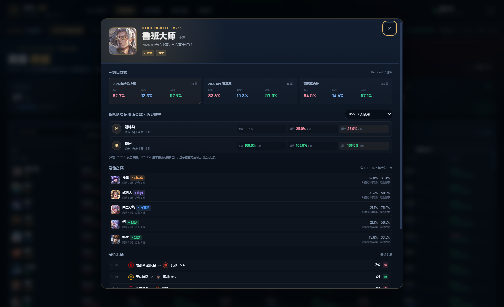
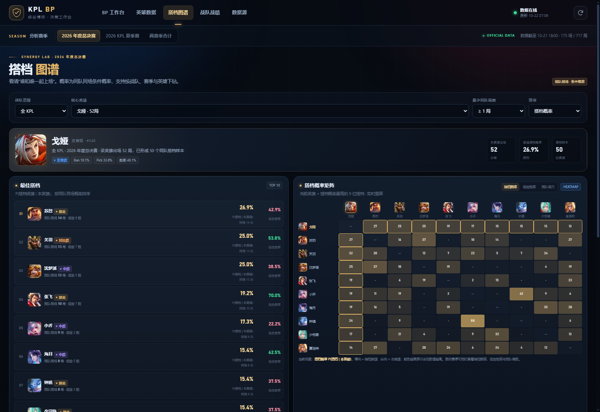
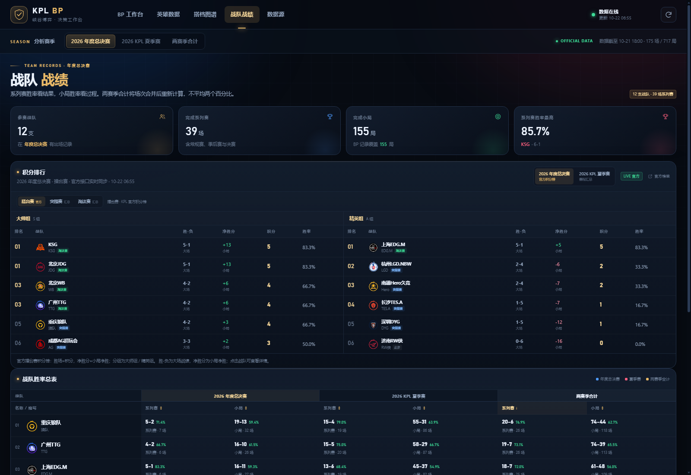
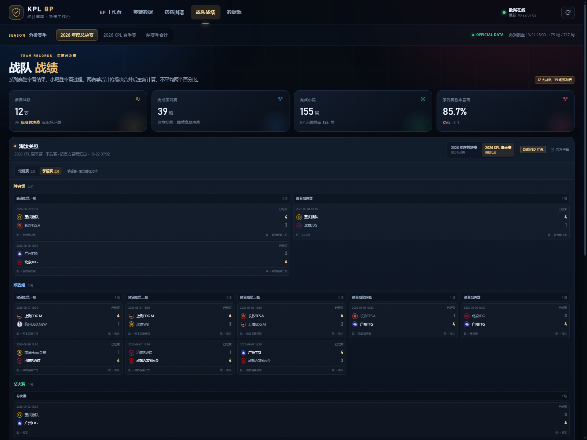

# KPL BP 决策台 · 峡谷博弈

王者荣耀 KPL 职业联赛的本地 BP（Ban/Pick）工作台。包含 2026 年度总决赛、2026 KPL 夏季赛，以及两赛季合计的英雄数据、搭档概率和战队战绩，并支持从腾讯官方赛事接口增量同步。

当前随包快照：**176 场系列赛 / 721 局 BP / 133 位英雄 / 18 支战队**，数据覆盖至 2026-10-22 18:00。

**版本：v1.1.0**

- GitHub 仓库：<https://github.com/AsuraZr/KPL-BP-Studio>
- KPL 官方直播：<https://pvp.qq.com/cp/kpl2026/index.html#s_top1>
- 软件顶部“检查更新”会读取 GitHub 最新 Release；如无法更新，请点击备用链接：<https://www.bilibili.com/video/BV1bsn26NEDN/?spm_id_from=333.1387.homepage.video_card.click&vd_source=e1276fab5b80acf4751c3ea7650850a1>



## 使用声明与许可

> **本软件已开源，永久免费供个人非商业使用。严禁利用本软件及源码进行任何形式的商业盈利活动，违者将依法追究责任。**

本项目原创代码采用 **PolyForm Noncommercial License 1.0.0**，版权归 **摸鱼の修酱（B站@摸鱼の修酱）** 所有，详见 [LICENSE](LICENSE) 与 [LEGAL_NOTICE.md](LEGAL_NOTICE.md)。

- **个人非商业使用永久免费**；学习、研究、测试、娱乐、业余爱好等非商业用途无需付费。
- **禁止任何商业盈利活动**，包括出售、付费服务、广告/流量变现、商业 SaaS、企业内部商业使用、商业培训/咨询等；商业使用须取得单独书面授权。
- 严格来说，由于禁止商业使用，本许可证**不属于 OSI 定义下的开源许可证**；“已开源”在本项目中指源代码公开可见，使用边界以许可证和法律声明为准。
- **官方赛事数据、英雄头像、战队 Logo、游戏截图等第三方内容不属于本许可证授权范围**，详见 [THIRD_PARTY_NOTICES.md](THIRD_PARTY_NOTICES.md)。
- 本项目为非官方粉丝工具，与腾讯、王者荣耀、KPL、B 站无隶属关系。

如需商业授权，请通过 B 站 **@摸鱼の修酱** 联系。公开仓库时，请将 `LICENSE`、`README.md`、`LEGAL_NOTICE.md`、`THIRD_PARTY_NOTICES.md` 放在根目录。

---

## 快速启动

### 方式零：直接运行 exe

双击：

```text
KPL-BP-Studio.exe
```

- 已打包 Python 运行时、网页、英雄头像素材、OpenCV 截图识别和 OCR 脚本，**不需要安装 Python**。
- 启动后会自动打开浏览器；关闭控制台窗口即停止本地服务。
- 首次启动会把数据快照写到 exe 同目录的 `data`；如果该目录不可写，则使用 `%LOCALAPPDATA%\KPLBPStudio\data`。
- 默认端口 `5170`；如被占用：

```bash
KPL-BP-Studio.exe --port 5180
```

- 未签名 exe 可能触发 Windows SmartScreen，需要手动选择“仍要运行”。
- 左上角“制作者：B站@摸鱼の修酱”水印可点击，会打开作者 B 站个人空间。

### 重新打包 exe（开发者）

需要 Windows x64、Python 3.10+，并安装可选依赖：

```bash
pip install -r requirements.txt pyinstaller
python -m PyInstaller --onefile --console --name KPL-BP-Studio ^
  --icon build-assets/kpl-bp.ico ^
  --add-data "web;web" --add-data "data;data" ^
  --add-data "ocr_windows.ps1;." ^
  --hidden-import=cv2 --hidden-import=numpy ^
  --distpath . --workpath build --specpath build kpl_bp_studio.py
```

生成结果：项目根目录的 `KPL-BP-Studio.exe`。

### 方式一：双击启动

双击项目根目录下的 **`start-kpl-bp.bat`**。脚本会启动本地服务并打开：

```text
http://127.0.0.1:5170
```

### 方式二：命令行

需要 Python 3.10+，不依赖任何第三方包：

```bash
cd kpl-bp-studio
python server.py --open
```

如果端口 5170 被占用：

```bash
python server.py --port 5180 --open
```

> `start-kpl-bp.bat` 会先验证 Python 是否真的可执行，避免把 Windows 应用商店的 `python.exe` 别名当成可用环境；也支持把便携运行时放在 `runtime\python.exe`。如果目标机器路径不同，请修改脚本里的 `PYTHON_FALLBACK`。
>
> DeepSeek Harness 里启动的本地服务是当前会话的子进程，退出 DSH 后不会自动常驻。需要独立运行时，请在文件夹中直接双击 `start-kpl-bp.bat`，并保持打开的黑色命令行窗口不关闭。

### 手机 / 局域网访问

页面本身已做移动端适配（390 / 360 / 320 宽度无页面横向溢出，宽表和矩阵在组件内部横向滑动）。但默认服务只监听 `127.0.0.1`，手机无法直接访问。让同一 Wi-Fi 下的手机访问时，用局域网监听方式启动：

```bash
python server.py --host 0.0.0.0 --port 5170
```

然后查看电脑的局域网 IPv4（Windows 可运行 `ipconfig`），在手机浏览器打开：

```text
http://电脑局域网IP:5170
```

例如本机当前为 `http://192.168.61.9:5170`。首次启动如弹出 Windows 防火墙提示，请允许“专用网络”。

> 局域网服务没有登录认证，只建议在可信 Wi-Fi 下使用；不要直接暴露到公网。



---

## 功能

### 1. BP 演练室

- 支持 **BO1 / BO3 / BO5 / BO7 / BO9** 系列赛，即连续 Ban/Pick 1、3、5、7、9 局。
- 普通小局采用 **全局 BP**：己方之前小局选过的英雄，之后不能再次选择；Ban 位每局重置。
- **BO7 第 7 局、BO9 第 9 局为巅峰对决**：
  - 无 Ban 位；
  - 双方盲选，不轮流出手；
  - 解除全局 BP 限制，己方前几局用过的英雄可以重新选择；
  - 双方可以拿到相同英雄（镜像阵容）；
  - 每方仍需选满 5 名不同英雄。
- 每局标准职业赛 **10 Ban / 10 Pick** 顺序，与官方 BP 记录顺序一致。
- 英雄选择区为**英雄头像网格**，点击头像直接落位。
  - 同位置英雄不会在英雄池中封锁，仍可正常选择；同位置限制只用于教练席推荐和 BP 位概率标记。
  - “全部”与单分路筛选使用相同的头像尺寸，不因滚动条或候选数量变化而缩放。
  - 桌面端英雄池面板顶部与双方 BP 区域底部对齐，底部与教练席建议整栏底部对齐；英雄头像选择区会随面板高度拉伸，不再在下方面板内留空。
- **选人先按顺位排列**：前 5 个选择依次进入 P1-P5，不预判分路；5 人齐后自动按英雄实际分路重新分配位置。
- **红色方镜像**：红方 Ban 位和 Pick 位都从右向左填充，第一手在最右侧；5 人齐后的分路位置也按镜像顺序展示。
- 蓝/红双方均可选择战队，或使用“全KPL（通用）”。
- 每局 BP 开始前提供 **“本局换边”**：交换本局蓝/红方战队；BP 一旦开始或结束即锁定。
- 每局 BP 完成后提供 **本局胜方选择**（蓝方胜 / 红方胜），选择后才能进入下一局。
- 按真实赛制计算系列赛比分：任一方先到多数胜局即系列赛结束，不再强行打满；BO7/BO9 只有在 3-3/4-4 时才会进入第 7/9 局巅峰对决。
- 支持撤销（`Ctrl+Z`）、重置本局、重置系列赛、复制本局阵容。
- **单槽换英雄**：在**当前局尚未选择胜方**时，点击已选的 Ban / Pick 头像，可只替换当前槽位英雄；不会清空其他 Ban/Pick、不会改变当前手数和进度。
- **历史 BP 只读**：点击系列赛进度条中的 G1/G2… 可回看当前大场之前的小局 BP 详情；历史局一律只读，不能换英雄。当前局一旦确认本局胜方，也会自动锁定，不可再改 BP。
- **锁定后的操作**：当前局锁定后仍可执行 **重置本局**、**重置系列赛**，或点击“解锁本局 BP”保留当前 BP 并恢复编辑。重置会清空对应 BP，解锁不会清空 BP，但需要重新选择胜方。
- **BP 顺位数字**：工作台 Ban / Pick 头像右下角显示该方 Ban 1-5、Pick 1-5 顺位。Pick 位仍按实际分路展示，因此完整阵容后顺位数字可能不按左右连续排列，但数字代表真实 Pick 顺序。
- **导入 BP**：支持逐行文本、JSON、`.txt` / `.json` 文件，或直接粘贴软件“复制本局”生成的完整文本。
  - 可直接识别导出文本中的 `蓝方 / 红方 / Ban / Pick / 本局进度`，按进度恢复当前手。
  - 逐行文本示例：`B 蓝 关羽`、`B 红 盾山`、`P 蓝 曹操`
  - JSON 示例：`[{"type":"ban","side":"blue","hero":"关羽"}]`
  - 标准局最多 20 手；巅峰对决只导入 Pick。
- **截屏识别**：导入弹窗支持上传王者营地 BP 回放截图。
  - **优先匹配英雄头像**：使用本机英雄头像模板做多尺度图像匹配，直接把头像转换成英雄 ID/英雄名；不是只依赖文字 OCR。
  - **BP 槽位识别**：先定位截图顶部的两排各 10 个头像（上排 Ban、下排 Pick，左右各 5），再逐槽匹配英雄，避免把下方“对位数据/出装铭文”里的玩家头像误当成 BP。
  - **唯一性 + 分路约束**：20 个槽位不会重复分配同一英雄；选人阶段会优先补齐对抗路/打野/中路/发育路/游走五个位置。
  - **OCR 辅助**：Windows 中文 OCR 作为文字兜底，可处理头像模糊但文字清晰的截图。
  - 识别结果会先填入文本框，必须人工核对后再导入，避免误识别直接覆盖 BP；皮肤头像、遮挡或低分辨率仍可能识别偏差。
  - 头像匹配需要可选依赖：`pip install -r requirements.txt`（numpy + opencv-python-headless）；OCR 辅助需要 Windows 简体中文 OCR 语言组件。核心 BP 功能不依赖这些可选依赖。
- “教练席建议”：
  - 移除推荐卡片里与英雄绑定的分路/位置信息，也移除了“分路补位”对推荐分的影响；
  - 结合当前赛季英雄 Ban/Pick 率、调整后胜率；
  - 结合已选英雄与候选英雄的同队搭档率；
  - 结合**本队在当前选边对全 KPL 战队的历史 Ban/Pick 数据**，不再只统计对当前对手的同边样本：
    - 蓝方教练数据取本队历史上作为蓝方、对任意 KPL 对手的 BP 样本；
    - 红方教练数据取本队历史上作为红方、对任意 KPL 对手的 BP 样本；
    - 当前赛季有同边样本时优先本赛季，否则回退两赛季合并；
  - 推荐列表扩展到 **10 位英雄**；
  - 按当前 B/P 位提高权重：当前是 B3/P3 时，优先参考本队历史上相同位置的 Ban/Pick 频率；同时 B1/P1 到 B5/P5 按“前重后轻”衰减；
  - 位置过滤：
    - 每名已选英雄取实际使用最多的分路作为“常用分路”；
    - **Ban 建议排除对方已选英雄的常用分路**；
    - **Pick 建议排除己方已选英雄的常用分路**；
    - 多分路已选英雄只排除其常用分路，次要分路对应的英雄仍可推荐；
  - 全局 BP 已用英雄排除。
  - 教练席底部新增 **BP 位概率**：对当前对手，可选择 **G1-G7 / 全部小局** 和 **B1-B5 / P1-P5**，分别展示本赛季 / 两赛季合并下，各英雄在该队该选边、该小局、该位置的出现次数、样本局数和概率；默认定位当前小局与当前 B/P 位，点击其他位置即可查看对应分布。该分布会把与当前已选英雄同位置的英雄标记为“同位置封锁”，但仍保留其历史概率。连续同方选人时会同时显示两个 Pick 位（例如红方全局 P2/P3、蓝方全局 P4/P5）的双列概率。下方保留当前已 Ban/Pick 后剩余英雄的 BP 率。只统计全局 BP 小局，随数据和 BP 进度实时重算。
- 当前 BP 面板下方实时显示双方：
  - 战队小局胜率；
  - 阵容平均英雄胜率；
  - 搭档组合胜率；
  - **阵容对位综合胜率**同时展示三个口径：
    - **全 KPL · 所选赛季**：己方 5 个英雄对位对方 5 个英雄的全联盟历史样本；
    - **本队队史 · 当前赛季**：只统计**当前双方战队在当前赛季交手**时，己方每个英雄对阵对方**对抗路 / 打野 / 中路 / 发育路 / 游走五个位置**英雄的历史胜率；
    - **本队队史 · 两赛季**：同样只统计**当前双方战队最近两个赛季交手**时的“英雄 vs 对方五个位置”历史胜率；
    - 三者均按对位样本局数加权汇总，并显示覆盖组合数与总样本局数；
  - 所有建议都只作分析参考，不是官方预测。

#### 赛制规则速查

| 赛制 | 小局数 | 普通小局 | 决胜局 |
| --- | --- | --- | --- |
| BO1 | 1 | 全局 BP | 无 |
| BO3 | 3 | 全局 BP | 无 |
| BO5 | 5 | 全局 BP | 无 |
| BO7 | 7 | 第 1-6 局全局 BP | 第 7 局巅峰对决（仅 3-3 时） |
| BO9 | 9 | 第 1-8 局全局 BP | 第 9 局巅峰对决（仅 4-4 时） |

- 全局 BP 只限制**己方**已经选过的英雄，不限制对方；因此对方用过的英雄，己方仍可选择。
- 全局 BP 只累计“选人”，不累计“Ban 人”。
- 巅峰对决的全局限制解除仅作用于该局，每方当前局仍不能重复选择同一英雄。
- 每局 BP 完成后必须选择本局胜方，才能进入下一局；先到 `ceil(BO/2)` 胜的一方赢得系列赛。
- 换边只影响当前小局的蓝/红方归属；全局 BP 的“己方已用英雄”按战队追踪，换边后不会把两队历史用英雄混淆。
- 红色方 Ban/Pick 从右向左填充；选满 5 人后才进行分路重排，分路位置同样镜像展示。
- **元流之子同族规则**（坦克 / 法师 / 刺客 / 射手 / 辅助）：
  - 任一方选中任一分路后，该方在后续全局 BP 中不能再选其他四个分路；
  - 对方在当前小局不能选元流之子的任何分路；
  - 己方教练席的 Pick 建议会移除全部元流之子分路；
  - 该规则按战队追踪，换边后仍按“选过元流之子的战队”生效。

### 2. 英雄数据

- **英雄分路以实际比赛为准**：不再直接使用英雄资料页的静态职业，而是按 2026 两个赛季官方逐局出场记录中的实际分路统计。
  - 例如：哪吒、杨戬、夏侯惇、元流之子（坦克）按打野；王维按中路；张良、墨子、赵怀真按游走；大乔按中路；卢雅那、蚩奼按发育路。
  - 若一名英雄实际使用过多个分路，会按实际场次从多到少保留主要分路；BP 自动落位、角色筛选和英雄详情都使用修正后的分路。
  - 英雄详情会显示“实际分路记录”，可查看该英雄在各赛季、各分路的实际出场次数。
- 每名英雄同时展示三组窗口：
  - 2026 年度总决赛；
  - 2026 KPL 夏季赛；
  - 两赛季合计。
- 每组都有 **Ban 率 / Pick 率 / 胜率**，并显示 Ban、Pick、胜局样本数。
- 支持搜索、分路筛选、仅看有登场、任意指标排序、导出 CSV。
- 英雄表排序优先级：
  - **Ban 率排行**：Ban 率 → 胜率 → Pick 率；
  - **Pick 率排行**：Pick 率 → 胜率 → Ban 率；
  - **胜率排行**：胜率 → Pick 率 → Ban 率。
- 点击英雄查看三窗口数据、全 KPL 最佳搭档和最近出场。
- **最近出场可点击**：点击最近出场中的任意一场，会打开对应战队的战队详情，并自动把“队员使用英雄”切换到当前英雄；关闭战队详情后会回到原来的英雄详情。
- **返回路径**：从 BP 工作台或英雄数据进入英雄详情，再点最近出场，返回时回到英雄详情；从战队系列赛的赛后数据进入英雄详情，返回时回到该场赛后数据（保留当前小局）。
- **战队队员使用该英雄的历史胜率**：
  - 英雄数据页新增“战队队员视角”：先选择战队，再点击任意英雄；
  - 详情弹窗会列出该战队使用过该英雄的选手，展示每名选手的年度总决赛、夏季赛、两赛季合计胜率与样本局数；
  - 战队详情弹窗也可先选战队，再选择英雄，查看同样的选手逐人数据；
  - 选手数据来自官方逐局出场记录，只统计 2026 两个赛季，随快照增量更新。



### 3. 搭档图谱

- 战队范围：各战队或全 KPL。
- 赛季范围跟随顶部赛季选择，支持两赛季合计。
- 核心英雄可下钻，展示：
  - `P(搭档 | 本英雄)` 同队同场条件概率；
  - `P(本英雄 | 搭档)` 反向概率；
  - 同队同场局数、组合胜率、相对基础 Pick 率的提升；
  - **搭档概率矩阵**：以当前选中英雄为第一行/列，自动取该英雄按当前指标排名最高的 9 位搭档组成 10×10 热力矩阵；
  - 矩阵指标可切换 **搭档概率 / 组合胜率 / 同队场次**，切换英雄或指标时即时重算；
  - 矩阵悬停可同时查看搭档概率、组合胜率、同队局数；
  - **最佳搭档**按同队场次与组合胜率综合评分排序，**全部搭档表也使用同一评分排序**；
  - 综合评分 = 50% 同队场次占比 + 50% 平滑后组合胜率，避免 1 局 100% 的小样本排到最前；
  - 全部搭档表，可按同队局数过滤。

公式：

```text
P(B|A) = A、B 同队同场的局数 / A 的出场局数
组合胜率 = 同队同场时获胜局数 / 同队同场局数
相对基准 = P(B|A) − B 在当前范围内的基础 Pick 率
```



### 4. 战队战绩

- 新增 **两赛季排名与积分排行表**：
  - 2026 年度总决赛：直接读取 KPL 官方页面的 **大师组 / 精英组实时积分榜**，包含组内排名、大场胜-负、小局净胜分、积分、胜率与晋级状态；
  - 2026 年度总决赛 **突围赛**：单败淘汰关系表，展示对阵、比分、胜者/败者去向；
  - 2026 年度总决赛 **淘汰赛**：胜者组 / 败者组 / 总决赛双败结构表；未开赛时显示待定对阵，开赛后填入赛果；
  - 2026 KPL 夏季赛：按官方常规赛赛果汇总 **常规赛总积分榜**（胜场=积分，净胜分=小局净胜），包含 18 支战队；
  - 2026 KPL 夏季赛 **季后赛**：官方胜者组 / 败者组 / 总决赛淘汰关系表，不再使用积分排行；
  - 赛季和阶段均可独立切换，不影响顶部赛季筛选；
  - 年度总决赛擂台赛额外展示 **KSG vs 北京JDG 擂台赛加赛（BO1）**，并注明官方积分榜不含该加赛、但战队系列赛战绩已计入；
  - 点击榜单中的战队可直接打开战队详情。
- 每支战队展示年度总决赛、夏季赛、两赛季合计的：
  - 系列赛战绩与系列赛胜率；
  - 小局战绩与小局胜率。
- 支持按任意窗口的系列赛/小局指标排序。
- 点击战队查看系列赛记录、常用英雄、本队 Ban、常用搭档，以及“队员使用英雄 · 历史胜率”（选择英雄后查看逐选手三窗口数据）。**点击“常用英雄”里的任意英雄**，会同步切换上方选手历史胜率面板。
- **系列赛记录默认列出该赛季全部比赛**，不再只显示最近 10 场；可按对手、阶段、日期、比分搜索；切到“两赛季合计”可搜索两个赛季所有系列赛。
- **点击系列赛记录中的任意一场**，可打开该系列赛的逐局「赛后数据对阵图」：按对抗路/打野/中路/发育路/游走对位，展示选手、英雄、K/D/A、经济和装备；中间突出双方击杀比分，比赛时间缩小为辅助信息。
- 赛后对阵图同时展示该局 **BP 数据**（双方 Ban / Pick）：BP 区域放大，蓝方从左至右、红方从右至左排列；每个英雄头像右下角显示该方 **Ban 顺序 1-5 或 Pick 顺序 1-5**（分开计数）；点击 BP 英雄头像或选手英雄栏，可打开该队员使用该英雄的历史胜率界面。
  - 如果系列赛是从战队详情打开的，关闭英雄历史胜率后会自动返回原战队详情，并保留原来的赛季和已选英雄。
- **选手对位数据**：按对抗 / 打野 / 中路 / 发育 / 游走分页，对比双方选手的 KDA 与评分、经济、输出伤害、承受伤害、参团率，并显示各自全队排名、伤害占比和左右对比条。
- 支持：
  - **复制 BP**：生成可被 BP 工作台导入的文本；
  - **载入 BP 工作台**：按实际系列赛 BO 数新建工作台，并自动还原**当前小局及之前所有小局**的 BP、胜负和全局 BP 记录；例：BO7 第 3 局会载入 G1-G3，后续 G4-G7 保持未开始。每小局胜方会先按官方对局实际换边映射回当前蓝红方，再写入工作台。
- 赛后数据来自官方逐局详情缓存，通过本地 `/api/battle?id=...` 按需读取，不把大体量详情塞进首页快照。
- 表内“系列赛”指一场 BO 赛的胜负；“小局”指单局比赛。





### 5. 数据源与实时更新

- 页面右上角刷新按钮 / “数据源”页“立即增量同步”可手动同步。
- 服务端默认 **每 180 秒** 自动增量同步一次；页面每 20 秒检查是否有新快照。
- 同步只请求新增或未缓存的完结对局；已完结单局 BP 不会重复请求。
- 积分榜随每次同步刷新：
  - 年度总决赛读取 KPL 官方赛事页面的 AMS 积分榜接口；
  - 夏季赛使用官方赛程接口重新汇总常规赛战绩，不需要额外登录。
- 数据快照文件：`data/snapshot.json`；缓存目录：`data/cache/`；官方积分榜缓存：`data/cache/standings/`。

---

## 数据来源说明

王者营地没有公开的 Web 数据 API 供第三方直接读取。本项目没有调用王者营地账号私有接口，而是直接接入腾讯王者荣耀官方赛事中台：

```text
https://prod.comp.smoba.qq.com/leaguesite/...
```

该服务是 KPL 官方赛事数据页使用的公开赛事接口，与王者营地赛事页所展示的赛程、BP 和战队数据同源。同步管线只使用公开接口，不需要登录账号、Cookie 或抓包 token。

主要接口：

| 接口 | 用途 |
| --- | --- |
| `/leaguesite/leagues/open` | 赛事索引 |
| `/leaguesite/matches/open` | 赛程 / 系列赛比分 |
| `/leaguesite/league/hero/settle_list/open` | 官方英雄汇总 |
| `/leaguesite/match/battles/open` | 某场系列赛的小局列表 |
| `/leaguesite/battle/open` | 单局 BP、胜方和阵容 |
| `https://smoba.ams.game.qq.com/ide/` | KPL 官网年度总决赛实时积分榜（AMS 图表） |

数据口径：

```text
Ban 率  = 被 Ban 次数 / 总小局数
Pick 率 = 出场次数 / 总小局数
胜率    = 出场胜局 / 出场次数
合计    = 两季分子、分母分别相加后重新计算
```

注意：

- 官方 BP 明细偶尔有极少对局缺少部分 Ban 记录。当前快照中 2026 夏季赛有 5 局没有 Ban 明细、4 局 Ban 数量不完整，因此该赛季 Ban 总次数略低于理论值；软件按可获取记录计入，并在数据源页注明。
- 官方接口可能有分钟级延迟、修订或缓存差异；以 KPL 官方和王者营地最终展示为准。
- 战队数据按战队维度汇总，不按某一场首发五人组拆分。
- 队员英雄胜率按官方逐局 `battle_player_list` 归属战队统计，选手转会/改名可能影响跨赛季身份归并；当前共 1546 条战队-选手-英雄组合记录。
- 所有英雄、战队、搭档和队员统计都只使用 2026 年度总决赛与 2026 KPL 夏季赛，不混入 2025 或挑战者杯数据。
- 战队战绩的阶段表：年度总决赛擂台赛直接读取官方积分榜；夏季赛常规赛为积分总榜；年度总决赛突围赛为单败淘汰关系表，淘汰赛为胜者组/败者组双败结构表，夏季赛季后赛为胜者组/败者组/总决赛淘汰关系表，均按官方系列赛赛果填入。
- 教练席的“同边全 KPL 历史”按**本队选边**拆分，但对手范围是全部 KPL 战队：
  - 蓝方教练数据取本队历史上作为蓝方、对任意 KPL 对手的全局 BP 局；
  - 红方教练数据取本队历史上作为红方、对任意 KPL 对手的全局 BP 局；
  - 当前赛季有同边样本时使用本赛季，否则回退两赛季合并。
- 独立的“BP 位概率”仍按**当前对手**（A 队 vs B 队）统计，按本赛季 / 两赛季合并分别展示 B1-B5、P1-P5 的最高频英雄及概率，并计算当前已封锁英雄后的剩余英雄 BP 率；只使用全局 BP 小局，不使用巅峰对决样本。
- 教练推荐不显示、也不参与计算英雄分路位置；分路只在 BP 选满 5 人后用于最终位置重排。

---

## 项目结构

```text
kpl-bp-studio/
├─ start-kpl-bp.bat       # Windows 一键启动
├─ server.py              # 本地静态服务 + /api/data + /api/status + /api/refresh
├─ sync.py                # 官方数据抓取、缓存、增量同步、快照计算
├─ data/
│  ├─ snapshot.json       # 浏览器读取的当前快照
│  ├─ status.json         # 同步状态 / 进度
│  └─ cache/              # 官方接口原始缓存（可删除，删除后下次全量重建）
└─ web/
   ├─ index.html
   ├─ styles.css
   ├─ app.js
   └─ assets/             # 本地英雄头像、战队 Logo
```

同步逻辑：

```text
sync.py
  → 发现 2026 年度总决赛 / 夏季赛
  → 抓取赛程、战队、英雄汇总
  → 抓取完结系列赛的小局列表
  → 抓取完结小局的 BP 详情（带本地缓存）
  → 以逐局记录重算英雄、战队、搭档概率
  → 原子写入 data/snapshot.json
```

常用命令：

```bash
# 增量同步（服务运行时也可直接执行）
python sync.py

# 忽略缓存，全量重新拉取（耗时较长）
python sync.py --force

# 只启动服务，不自动打开浏览器
python server.py
```

环境变量：

```text
KPL_PORT=5170                 # 服务端口
KPL_AUTO_SYNC_SECONDS=180     # 自动同步间隔（秒）
```

---

## 已知限制

- 本工具是第三方本地分析工具，不是王者荣耀官方客户端。
- “教练席建议”是可解释的启发式评分，不是训练过的胜率预测模型；样本少的组合波动会很大。
- 普通小局 BP 顺序按当前官方 BP 列表顺序固定为 10 Ban / 10 Pick；若未来赛制调整，需要修改 `web/app.js` 中的 `DRAFT_STEPS`。
- 巅峰对决按照“双方盲选、可镜像、无 Ban、每方 5 名不同英雄”实现；如果你所在赛事规则禁止镜像，需要额外加一条校验。
- 系列赛默认需要逐局完成 BP 后手动进入下一局；软件不自动判定大比分结束，方便完整演练 BO7/BO9 的全局 BP 与巅峰对决。
- 阵容分析中的“平均胜率”是所选中英雄在该赛季的出场胜率简单平均，不代表阵容真实强度。
- 页面使用本地静态资源；首次启动时如果 `web/assets/` 缺失，会回退到腾讯 CDN 头像/Logo。

---

## 建议使用流程

1. 双击 `start-kpl-bp.bat`。
2. 在顶部选择“2026 年度总决赛”“2026 KPL 夏季赛”或“两赛季合计”。
3. 在 BP 工作台选择双方战队，按顺序点击英雄进行演练；观察教练席建议和右侧即时分析。
4. 在“英雄数据”里核对版本 Ban/Pick/胜率；点击英雄查看搭档与最近出场。
5. 在“搭档图谱”里针对某支战队研究核心英雄的同队组合。
6. 在“战队战绩”里核对系列赛和小局双口径战绩。
7. 需要最新数据时，点右上角刷新或到“数据源”页手动同步；服务端也会自动更新。
